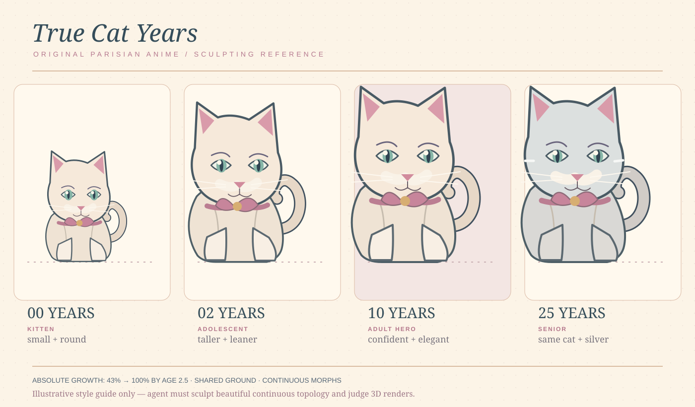
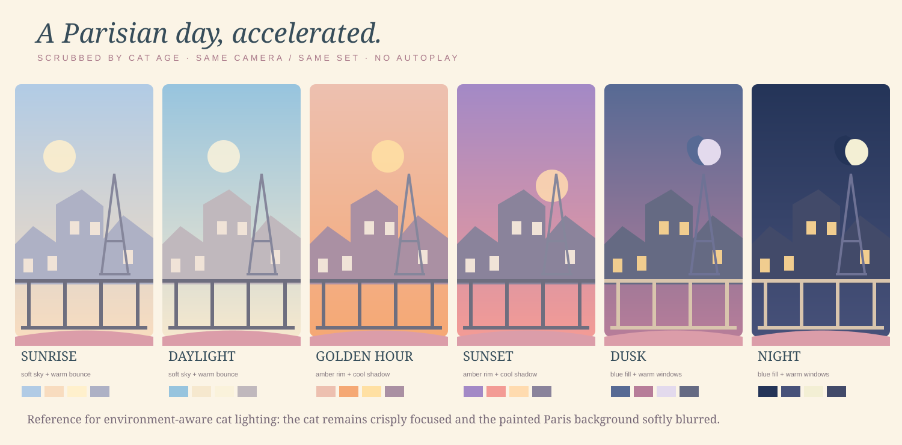

# Blender production kit

The website still runs as a static Cloudflare Pages site. This separate Blender production kit prepares an original 3D character; it does NOT require Blender in the GitHub Pages or Cloudflare build.

**Start here:** [Agent art brief](AGENT_BRIEF.md)

## Reproduce the starter scene

Requires Blender 4.2+ (tested against documented bpy APIs, but **not executed in this ChatGPT workspace**, where Blender is not installed).

From the repo root:

~~~bash
blender --background --python blender/scripts/build_scene.py -- --output-dir blender/output
blender --background blender/output/scene.blend --python blender/scripts/validate_scene.py
~~~

The build script is intended to save an editable BLOCKOUT scene at blender/output/scene.blend and four same-camera preview renders (age-00.png, age-02.png, age-10.png and age-25.png). It creates no real premium sculpt: your agent must iterate on the silhouette, face, topology and materials.

For quicker iteration without rendering:

~~~bash
blender --background --python blender/scripts/build_scene.py -- --output-dir blender/output --skip-renders
~~~

See [reference guidance and image prompts](references/README.md). Keep all assets local, no downloads or paid APIs. Blender outputs are initially gitignored: after approving the source and renders, explicitly force-add selected scene.blend, cat.glb and preview files if desired.

## Re-render and export an improved Blender scene

Once your coding agent improves and saves scene.blend, **do not re-run build_scene.py** (it resets the scene). Instead, operate on the updated BLEND:

~~~bash
blender --background blender/output/scene.blend --python blender/scripts/render_checkpoints.py -- --output-dir blender/renders
blender --background blender/output/scene.blend --python blender/scripts/validate_scene.py
blender --background blender/output/scene.blend --python blender/scripts/export_glb.py -- --out blender/exports/cat.glb
~~~

The GLB export is a pipeline smoke test until the premium character has been visually approved. Named shape keys on CatHead and CatBody become morph targets. The export selects only the character collection, excluding the preview stage, camera and lights. For a final artist-modified model, inspect morph and material fidelity in a glTF viewer before browser integration.

## Integration contract

- Do NOT automatically replace the current cat-scene.js renderer on main.
- Final deliverables: editable .blend, compact cat.glb with shape keys, same-camera age preview images, 3-angle turnaround, lighting strip and measured file/geometry budget.
- Retain model.js and cat-growth.js behaviour. Adult height must stop growing by age ~2.5; senior colour changes should be subtle.
- Keep mobile fallback and current slider-only fast-forward Paris day/night background.

## Repo-local assets

- scripts/build_scene.py — low-poly coherent-surface blockout scene generator
- scripts/render_checkpoints.py — render ages from a saved, edited BLEND without resetting sculpt edits
- scripts/export_glb.py — export only the character and morph targets as GLB
- scripts/validate_scene.py — source-scene and age-continuity checks run by Blender
- references/character-turnaround.svg — silhouette / proportion art board
- references/paris-lighting.svg — day-night colour and lighting art board
- references/README.md — exact creative prompts and reference policy
- AGENT_BRIEF.md — detailed production goals, QA and handoff

The initial generated BLEND is not committed yet because there is no Blender executable in this workspace; the script makes it on your Blender-equipped agent.
